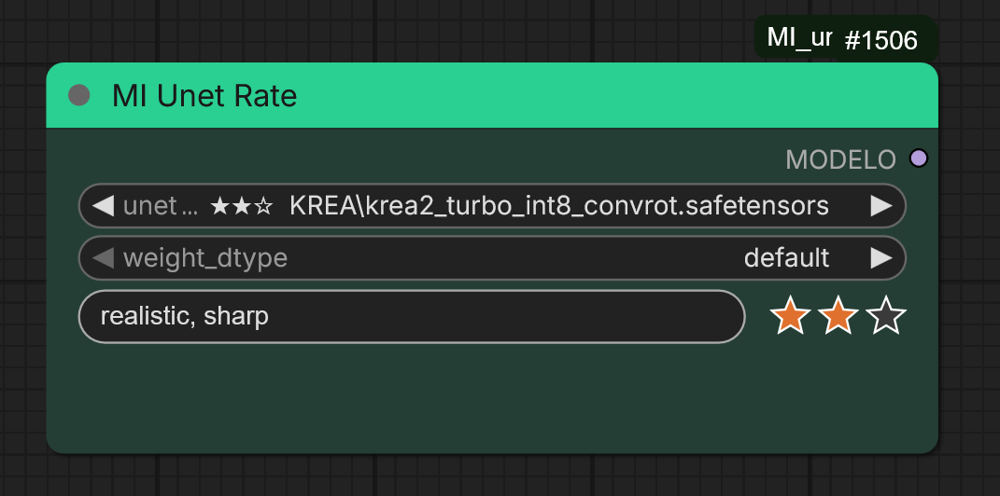

# MI Unet Rate

A UNET / diffusion-model loader for [ComfyUI](https://github.com/comfyanonymous/ComfyUI) that lets you **rate** and **comment** every model right where you pick it.

If you keep dozens of checkpoints and fine-tunes in your `diffusion_models` folder, file names alone are not enough to remember which ones are worth using. MI Unet Rate keeps your own judgement next to each model, so you can see it at a glance every time you open the list.



## Features

- **Rate each model from 1 to 3 stars.** One click on the row under the model selector; the rating is remembered for that model.
- **Leave comments on each model.** Write whatever you want to remember: the kind of images it does best, its quality, the best sampler and scheduler, ideal steps and CFG, resolution that works, known problems…
- **Everything visible at a glance.** Stars are shown in front of the model name, both in the dropdown list and in the selected value, so you can scan the whole list and spot your favourites. Models without a rating are left blank and stay aligned.
- **Drop-in replacement for the standard UNET loader.** It outputs `MODEL` and has the same `unet_name` and `weight_dtype` inputs, so you can swap it into any existing workflow.
- **Your data stays local.** Ratings and comments are saved in plain JSON files inside the node folder. Nothing is sent anywhere.

## Installation

Clone this repository into your ComfyUI `custom_nodes` folder and restart ComfyUI:

```bash
cd ComfyUI/custom_nodes
git clone https://github.com/ThinkingBells/MI_unet_rate.git
```

Then reload the browser tab (Ctrl+F5) so the new interface code is loaded.

## Usage

1. Double-click the canvas, search for **MI Unet Rate** (category `MI nodes`) and add the node.
2. Pick a model in `unet_name`.
3. In the row below the selectors:
   - **Stars (right):** click star 1, 2 or 3 to set the rating. Clicking the last active star removes one star, so you can lower the rating or clear it completely.
   - **Comments (left):** click the field, type your note and confirm. It is a single line, up to 300 characters, and is saved for the selected model.
4. Switch to another model and the stars and the comment change with it.

Ratings and comments are shared by every MI Unet Rate node and every workflow, because they belong to the model, not to the node.

## Where the data is stored

| File | Content |
| --- | --- |
| `ratings.json` | Model name → rating (1–3) |
| `notes.json` | Model name → comment |

Both files are created in the node folder the first time you rate or comment a model. They are ignored by git, so your personal notes are never committed. Back them up if you want to keep them.

## Good to know

- Ratings and comments are tied to the model's **path and file name** inside the models folder. If you rename or move a model file, it is treated as a new model; edit the keys in the JSON files if you want to carry the data over.
- If you delete a model, its rating and comment stay in the JSON files and come back if the model returns.
- New models appear in the list after refreshing ComfyUI (`R`) or restarting it.

## License

[MIT](LICENSE) © 2026 Thinkingbells
